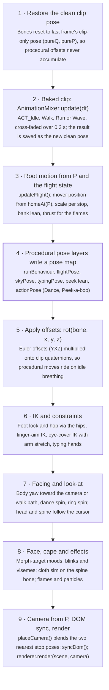
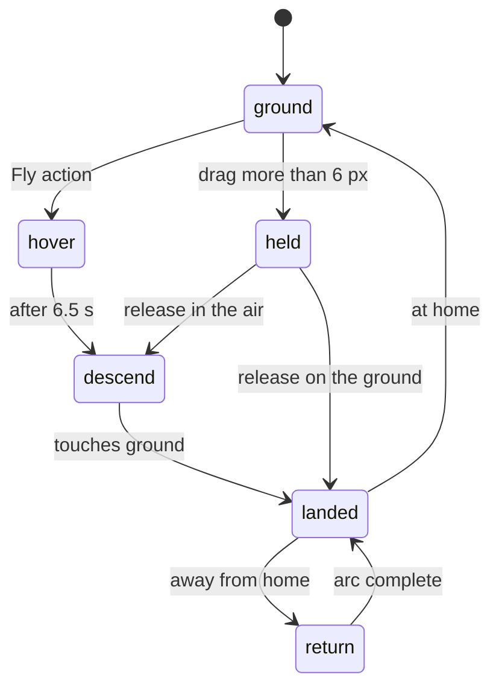

# Geoman Website — Technical Analysis

> How the Geotech "Geoman" site is built: the 3D model, how its actions (flight, dance, peek-a-boo and more) are animated, and what drives the scroll.
>
> Analysed: November 10, 2026

## Contents

1. [Executive summary](#executive-summary)
2. [Tech stack and delivery](#tech-stack-and-delivery)
3. [The 3D model: how Geoman is designed](#the-3d-model-how-geoman-is-designed)
4. [Rendering pipeline](#rendering-pipeline)
5. [Animation architecture: how motion is layered](#animation-architecture-how-motion-is-layered)
6. [Action catalogue: how each move is animated](#action-catalogue-how-each-move-is-animated)
7. [Cape: Verlet cloth simulation](#cape-verlet-cloth-simulation)
8. [Scroll control: what drives the page](#scroll-control-what-drives-the-page)
9. [Scene choreography by stop](#scene-choreography-by-stop)
10. [Pointer interaction](#pointer-interaction)
11. [Architecture review: strengths, risks, recommendations](#architecture-review-strengths-risks-recommendations)
12. [Appendix: source map and debug hooks](#appendix-source-map-and-debug-hooks)

---

## Executive summary

The site is a single, self-contained HTML page (about 1.3 MB) that tells the Geotech story through 19 "stops", hosted by a rigged 3D robot called Geoman. Everything is built on raw **three.js r170**. There is no React, no GSAP, no scroll library and no physics engine.

The three things this analysis covers:

- **The model** is a Blender-authored glTF 2.0 binary (GLB, 593 KB) that has been optimised with glTF-Transform v4.5.1 and base64-embedded in the page. It has 34 rigid skinned parts on one 31-bone armature (`RIG_Geoman`), 9 PBR materials and facial shape keys for the eyes and mouth.
- **The animation** combines a few baked clips with a lot of code. Only four clips ship in the file: Idle, Walk, Run and Wave. **Fly, Dance, Peek-a-boo, talking, thinking and the bug hunts are procedural.** They are bone rotations computed every frame from easing curves, plus small analytic IK solvers, a cloth simulation for the cape and shader-driven booster flames.
- **Scroll is hijacked, not native.** The page body is `overflow:hidden`. Wheel, touch and keyboard input each step a single float `P` (0–18) by one stop, and a custom tween eases `P` over 1.15–2.2 s. Everything is a pure function of `P`: camera, robot position and scale, props, lighting and the opacity of the DOM text.

---

## Tech stack and delivery

The page needs no build step and no bundler. One `<script type="module">` (about 2,270 lines) holds all the logic, and every binary asset is inlined.

| Layer | What is used | Notes |
| --- | --- | --- |
| 3D engine | three.js 0.170.0 | Loaded from jsDelivr via an `importmap` (`three`, `three/addons/`) |
| Addons | `GLTFLoader`, `RoomEnvironment`, `RoundedBoxGeometry` | Nothing else: no post-processing, no controls |
| Robot asset | GLB in `<script id="glb" type="application/octet-stream">` | Base64, decoded with `atob` → `ArrayBuffer` → `GLTFLoader.parse()` |
| Cape asset | Second GLB in `<script id="cape">` (166 KB) | Exported straight from Khronos glTF Blender I/O v5.2.39 |
| Globe data | `landmask` (1-bit 360×180 land grid, 8 KB) and `borders` (Int16 polylines, 32 KB) | Natural Earth 110m outlines, used for the contact-section globe |
| Procedural props | Laptop, desk, podium, bug, clouds, globe, rings | Built in code from primitives, with `CanvasTexture` for screens, clouds and pins |
| Fonts and icons | Poppins and Material Symbols Rounded (Google Fonts) | The action-menu icons are Material Symbols ligatures |
| UI layer | Plain HTML sections plus CSS | Each `.stop` section is `position:fixed` and is shown and hidden from JS |

The base64 `<script type="application/octet-stream">` trick lets the page ship as one file. The browser does not execute that block, so it acts as an inert data container.

---

## The 3D model: how Geoman is designed

Geoman is a chibi robot modelled in **Blender** as separate hard-surface pieces, each rigidly bound to one bone ("segmented rigging"), not a single deforming skin. The naming convention gives this away: `ME_*` for meshes, `SK_*` for skinned objects, `M_*` for materials, `T_*` for textures, `ACT_*` for actions and `RIG_*` for the armature. It was then run through **glTF-Transform v4.5.1** (`KHR_mesh_quantization`: positions stored as normalised int16 and weights as uint8) to bring it down to 593 KB.

### Geometry and rig

- **34 skinned meshes**, for example `ME_Head_Shell`, `ME_Faceplate`, `ME_Chest_Shell`, `ME_Back_Shell`, `ME_Emblem`, `ME_Boot_L/R`, `ME_ShoulderBall_L/R`, `ME_KneeBall_L/R` and `ME_Antenna_Ball/Stem`. The ball joints at the shoulders, hips and knees hide the seams when limbs rotate, which is the classic trick for rigid-part robots.
- **31 bones** in one armature. There are no feet or toe bones because the boots ride on the shin.
- Every mesh has `JOINTS_0` and `WEIGHTS_0`, so all parts follow the same skeleton. This is what lets one `AnimationMixer` drive the whole robot.

```text
RIG_Geoman
└── hips
    ├── spine
    │   ├── neck
    │   │   └── head
    │   │       └── antenna
    │   ├── upper_arm.L → forearm.L → hand.L
    │   │                              ├── index_01.L → index_02.L
    │   │                              ├── middle_01.L → middle_02.L
    │   │                              ├── pinky_01.L → pinky_02.L
    │   │                              └── thumb_01.L → thumb_02.L
    │   └── upper_arm.R → forearm.R → hand.R   (same fingers, .R)
    ├── thigh.L → shin.L
    └── thigh.R → shin.R
```

### Materials (PBR, `MeshPhysicalMaterial` after loading)

| Material | Look | glTF extensions |
| --- | --- | --- |
| `M_White_Plastic` | Main shell, slightly metallic, roughness 0.28 | clearcoat 0.3 |
| `M_Blue_Plastic` | Accent panels, roughness 0.25 | clearcoat 0.3 |
| `M_Dark_Blue` | Deep-blue trim | clearcoat 0.3 |
| `M_Blue_Joint` | Glossy joint balls, roughness 0 | clearcoat 1.0 |
| `M_Gray_Metal` | Metal details | none |
| `M_Dark_Faceplate` | Near-black visor, roughness 0.06 | clearcoat 0.5 |
| `M_Face_Emissive` | Glowing eyes and mouth | emissive_strength 1.46, specular 0 |
| `M_Cyan_Emissive` | Antenna bulb glow | emissive_strength 1.37, sheen, clearcoat |
| `M_Emblem_Glass` | Chest logo, textured by `T_Emblem_Palette_BC` | transmission 0.55 (disabled at runtime) |

At load time the code turns transmission off on the emblem, because a transmission pass is expensive. It also clones the materials of the faceplate, the antenna bulb and the emblem so those three can be animated without affecting shared materials.

### Facial expressions: morph targets

The face is not a texture. It uses Blender **shape keys** exported as glTF morph targets:

- `ME_Eye_L` and `ME_Eye_R`: `Closed`, `Happy`, `Angry`, `Sad`, `Wide`
- `ME_Mouth`: `Neutral`, `Frown`, `Grin`, `O`

Code sets `morphTargetInfluences` every frame to produce moods, blinks and lip-sync (see [Animation architecture](#animation-architecture-how-motion-is-layered)).

### Baked animation clips (the only keyframed motion)

| Clip | Length | Keys | Channels |
| --- | --- | --- | --- |
| `ACT_Idle` | 2.00 s | 45 | 93 (31 bones × translation, rotation and scale) |
| `ACT_Walk` | 1.00 s | 25 | 93 |
| `ACT_Run` | 0.67 s | 17 | 93 |
| `ACT_Wave` | 2.46 s | 57 | 93 |

All four are sampled at about 24 fps with LINEAR and STEP interpolation. **There is no Fly, Dance or Peek clip in the asset.**

### The cape (separate asset)

`SK_Cape` is a 17×19 grid of cloth vertices exported on its own, with a woven-fabric material: `T_Cape_Fabric_N` (normal), `_BC` (base colour) and `_ORM` (occlusion, roughness, metalness), tiled 6×7 via `KHR_texture_transform`, plus sheen. It is not skinned; it is driven by the [cloth simulation](#cape-verlet-cloth-simulation).

---

## Rendering pipeline

Rendering is a single forward pass: one `WebGLRenderer`, one scene and one camera, with no post-processing. The glow effects come from emissive materials, additive sprites and custom shaders rather than bloom.

```js
renderer = new THREE.WebGLRenderer({ canvas, antialias: true, alpha: true });
renderer.setPixelRatio(Math.min(devicePixelRatio, 2));
renderer.outputColorSpace = THREE.SRGBColorSpace;
renderer.toneMapping = THREE.AgXToneMapping;   // filmic, handles bright emissives gracefully
renderer.toneMappingExposure = 1.05;
renderer.shadowMap.type = THREE.PCFSoftShadowMap;
scene.environment = pmrem.fromScene(new RoomEnvironment(), 0.04).texture;  // IBL reflections, no HDR file
```

- **Canvas.** `#gl` is `position:fixed; inset:0` with a transparent background (`alpha:true`). The CSS gradients, sky and city backgrounds sit behind it as DOM layers.
- **Lighting.** A key `DirectionalLight` (2.3, 2048² soft shadow map), a cool rim light, a `HemisphereLight` fill and two point lights: one under the boots for booster glow and one on the face. **The key light's position is keyframed per stop** (array `kp[19]`) so the robot's shadow always falls away from the text column.
- **Shadows.** A `ShadowMaterial` disc (opacity 0.16, or 0.32 in dark mode) catches the robot's shadow. Its opacity fades out while he is in the sky.
- **Camera.** A `PerspectiveCamera` with FOV 28 (52 inside the visor). It uses `setViewOffset()` to **shift the lens off-centre** so Geoman sits beside the copy without moving him in world space.
- **Custom GLSL.** There are hand-written `ShaderMaterial`s for the booster flames, the particle points, the podium hologram beam and the laptop screen cross-fade. `onBeforeCompile` patches inject the chevron print into the cape and draw the animated outline glow around the emblem.
- **Canvas textures.** The laptop screens, clouds, globe pins and the animated face display (€ eyes, a clock, live-typed code) are drawn with the 2D canvas API into `CanvasTexture`.
- **Particles.** One `THREE.Points` pool works as a ring buffer (`emit()`), with per-particle colour, size, alpha and gravity. It is used for booster sparks, landing dust, the bug splat and zap sparks.
- **Theming.** `prefers-color-scheme` plus a manual toggle (stored in `localStorage`) retint the environment intensity, shadows, clouds, globe, podium and rings at runtime.

---

## Animation architecture: how motion is layered

Geoman's motion is a **layered animation system**. Every frame, a baked clip produces a base pose, and code adds procedural offsets, IK corrections and look-at on top. The trick that makes this stable is resetting the bones to the clean clip pose before each mixer update, so offsets never compound.

**Every frame, procedural layers ride on top of a clean baked-clip pose:**



Only stage 2 uses keyframes. Stages 3–8 are code, which is why Fly, Dance and Peek-a-boo need no extra clips.

```js
// stage 1–2: keep the clip pose clean, then let the mixer advance it
for (const n in bones) { bones[n].quaternion.copy(pureQ[n]); bones[n].position.copy(pureP[n]); }
mixer.update(dt);
for (const n in bones) { pureQ[n].copy(bones[n].quaternion); pureP[n].copy(bones[n].position); }
// stage 4–5: layers write Euler offsets into a plain object, then compose onto the clip
const pose = runBehaviour(dt); flightPose(pose); skyPose(pose, skyK, t); actionPose(pose, dt);
for (const [n, r] of Object.entries(pose)) rot(n, r[0], r[1], r[2]);   // quaternion.multiply(offset)
```

The robot also sits inside three nested groups, each owning one kind of root motion:

- `mover` holds position, scale and bank lean, driven by `P` and the flight state.
- `facing` holds the yaw toward the camera, the walk path or the ring spin.
- `aimer` holds the extra yaw when he aims at a bug, the dance pirouette and the peek lean.

All the timing curves are built from `ease` (smoothstep), `easeIO` (cubic), `seg` (windowed 0–1) and `bell` (a sine pulse). Followers use frame-rate-independent exponential smoothing: `x += (target − x) · (1 − e^(−dt·k))`.

---

## Action catalogue: how each move is animated

The hover menu (`#actions`, six `.act` buttons) calls `doAction(name)`. Each action is either a baked clip, a procedural pose script driven by `act = { name, t, dur }`, or a state machine.

| Action | Technique | Duration | Key code |
| --- | --- | --- | --- |
| Wave | Baked `ACT_Wave`, `LoopOnce`, cross-fades back on the mixer's `finished` event | 2.46 s | `play('wave')` |
| Walk | Baked `ACT_Walk` at `timeScale 1.5` | 3.4 s | `act = {name:'walk'}` |
| Run | Baked `ACT_Run` | 2.6 s | `act = {name:'run'}` |
| Fly | Flight state machine plus procedural leg pose plus shader flames | about 6.5 s, then a descent | `startFly()`, `updateFlight()` |
| Dance | Fully procedural sine-wave pose plus a 360° spin | 4.4 s | `actionPose()` |
| Peek-a-boo | Procedural pose plus analytic arm IK onto the eyes plus morph targets | 3.6 s | `actionPose()`, `coverEyes()` |

### Fly

Flying combines four systems.

1. **Position: a finite-state machine.** `flight` moves through `ground → hover → descend → landed → return → ground`. The `held` state is entered when the user drags him. In `hover`, height eases up over 1.2 s to `0.3 × scale` with a `sin(flyT·2.2)` bob and a slow sideways sway. After 6.5 s it switches to `descend`, which integrates a velocity toward −0.45 m/s with damping. `land()` then emits 30 dust particles and starts a hip-dip squash. If he lands away from home, `return` flies him back along a sine arc, and the arc is taller if the laptop lid is in the way.
2. **Body pose.** `flightPose()` bends the knees (shin 0.45 and 0.55 rad) and swings the thighs on out-of-phase sines, all scaled by `thrust`. The whole `mover` banks on Z in proportion to sideways velocity (`lean = clamp(-vel.x·0.3)`).
3. **Booster flames.** At load time two open `ConeGeometry` flames are parented to the shin bones, positioned at each boot sole (found from the boot mesh's bounding box). A fragment shader fades alpha along the cone and flickers with `sin(t·45 + uv.x·30)`. Their length scales with `thrust`, which eases toward 1 whenever he is airborne. A point light under him pulses at 40 Hz and sparks are emitted at about 90 per second × thrust.
4. **Face.** The `flying` mood gives Happy eyes and a Grin plus O mouth.



In the "How We Build" stops (P between 5 and 13), flight is scroll-driven rather than an action. `homeAt()` lifts him to `SKY` (y = 0.35), `skyPose()` straightens his legs into a superhero pose, the cape unrolls and clouds stream past.

### Dance

Dance has no keyframes. It is pure trigonometry on bone rotations, faded in and out by an envelope `k = min(1, t/0.4, (dur−t)/0.4)`.

```js
b = Math.sin(t * 7);                                       // arm beat at about 1.1 Hz
pose['upper_arm.L'] = [0.2*k, 0,  (0.35 + 0.25*b)*k];       // arms pump up and down
pose['upper_arm.R'] = [0.2*k, 0, -(0.35 - 0.25*b)*k];
pose['forearm.L/R'] = [0.7*k, 0, 0];                        // elbows bent
pose['hips']  = [0, 0,  0.12*sin(t*3.5)*k];                 // hip sway
pose['spine'] = [0, 0, -0.10*sin(t*3.5)*k];                 // counter-sway keeps the head over the feet
pose['head']  = [0, 0,  0.15*b*k];                          // head bob on the beat
pose['shin.L'] = [0.28*|sin(t*3.5)|*k]; pose['shin.R'] = [0.28*|cos(t*3.5)|*k];  // alternating knee bounce
danceSpin = 2π * easeIO(seg(t, 1.6, 2.8));                  // one full pirouette mid-dance
```

Setting `footLock = 'both'` makes `groundAndAim()` re-plant both soles on the floor every frame. This is a cheap foot-IK: it measures the lowest sole and shifts the hips down by the difference, so the knee bends never make him float.

### Peek-a-boo

The hands come up over the eyes (`cover` eases in from 0.15 to 0.75 s and holds until 2.2 s), then the arms throw out for "Boo!" (a `bell()` from 2.35 to 3.4 s) while a speech bubble appears. Because his chibi arms cannot reach his visor, `coverEyes()` runs a **3-iteration analytic IK**. It rotates each upper arm so the palm aims at the eye centre, which was cached at load from the eye mesh's bounding box, and **temporarily scales the arm up to 1.7×** only while it covers. The face goes from Closed eyes and a Grin to Happy eyes and an O mouth.

### Idle behaviours (hero and About stops only)

When Geoman is idle at stops 0–1, `runBehaviour()` cycles through `talk → think → bugs` with gaps of about 1.2 s.

- **Talk.** A line is typed into a DOM bubble at 22 characters per second. Each character maps to a mouth viseme (`o/u/w → O`, `e/i/y → Grin`, `m/b/p → Neutral`, and so on), which gives cheap lip-sync with no audio.
- **Think.** A thought bubble with dots, then a line, a hand to the chin and eyes looking up and to the side.
- **Bug hunt** alternates between two scripts. *Stomp*: a procedural bug crawls to his toe, he crouches, tucks the right knee and stomps (foot-locked), with a camera shake, splat particles and a sweep-up. *Zap*: he turns toward the bug, curls three fingers into a point, a one-bone look-at IK aims the index finger, a 0.3 s beam (additive cylinders) fires, and he blows on the fingertip.

---

## Cape: Verlet cloth simulation

The cape is simulated physically with a hand-written **position-based Verlet cloth solver**. It is not animated by keyframes or bones.

- **Grid recovery.** The rows and columns of the Blender mesh are rebuilt from its UVs (17×19), so vertex order after export does not matter.
- **Particles.** Each vertex has a position, a previous position and an inverse mass. Rows 0–2 (the collar) are pinned with mass 0. Rows 3–7 are softly pulled toward their sewn rest shape so the upper back hugs the body.
- **Constraints.** Structural links (stiffness 1.0), shear diagonals (0.6) and bend links that skip a vertex (0.35), relaxed over 6 iterations.
- **Forces.** Gravity, damped drag toward an airflow vector that points down and back (`climb` is stronger in the sky, during a transition and during a boost), and procedural sine "gusts".
- **Collision.** Sphere colliders are auto-fitted at load. Each body mesh's bounding box is packed with spheres sized by its thinnest side and bound to its bone. Particles inside a sphere are projected out, and their previous position is moved too so the push adds no energy.
- **Space and stability.** The solve runs in the **spine bone's local space** with a fixed timestep of 1/240 s. World motion such as ring spins and take-off enters only as a 30% inertia carry-over, so breathing and idle sway do not jitter the cloth. A light exponential smoothing is applied for display.
- **Shading.** `onBeforeCompile` injects a Geotech chevron, drawn from SVG paths into a canvas texture, on the front face only, mapped from rest positions rather than UVs so it does not taper. The back face is lightened to read as lining.
- **Reveal.** A `reveal` uniform scales every vertex toward its collar point, so the cape "unrolls" between P = 5.15 and 5.75 and rolls back up before landing.

---

## Scroll control: what drives the page

**No scroll library is used.** There is no GSAP ScrollTrigger, Lenis, Locomotive or native scrolling at all. The document never scrolls (`body { overflow:hidden; overscroll-behavior:none }`). Instead, a custom **stepped "scrollytelling" controller** maps each gesture to one discrete stop and animates a single float through the transition.

### 1. One number drives everything

```js
const N = 19;                     // stops 0..18
let P = 0, target = 0, tween = null;
```

`P` is the story's progress. An integer value means "at a stop" and a fraction means "between stops". Every visual is computed from `P` each frame, so the scene is effectively a pure function of `P` plus a few interaction states. This is what makes direct jumps and deep links (`#build`, `#contact`) trivial: set `P` and the whole world is consistent.

### 2. Input becomes one step

```js
addEventListener('wheel', e => {
  e.preventDefault();                                 // passive:false, kills native scroll
  if (grab?.held || Math.abs(e.deltaY) < 6 || !canStep()) return;
  go(target + Math.sign(e.deltaY));                   // one gesture = one stop
}, { passive: false });
// touch: a swipe of more than 45 px; keys: arrows, PageUp/PageDown, Space; Home/End jump
function canStep() { return !tween && !dissolving && performance.now() - lastEnd > 380; }
```

`canStep()` is the debounce. It ignores input while a transition runs and for 380 ms after one ends, which absorbs trackpad inertia so a single flick never skips two stops.

### 3. A custom tween with eased duration

```js
function go(i) {
  tween = { from: P, to: i, t: 0,
            dur: reduceMotion ? 0.001 : Math.min(2.2, 1.15 + 0.3 * (dist - 1)) };
}
// in the frame loop:
tween.t += dt / tween.dur;
P = lerp(tween.from, tween.to, easeIO(Math.min(1, tween.t)));   // cubic ease-in-out
```

### 4. Long jumps dissolve instead of fast-forwarding

Nav links, the progress rail, tabs and the logo call `jumpTo(i)`. Moving to an adjacent stop plays the normal tween. A farther jump fades the `#fade` overlay to full opacity, polls `getComputedStyle` until it is fully covered, calls `snapTo(i)` (which sets `P`, cancels flight and drag, and teleports the robot), then fades back in. This avoids replaying many animations in between.

### 5. Mapping P to the world: segment easing helpers

Every choreographed property is written with three tiny helpers:

```js
seg(t, a, b)  = clamp01((t - a) / (b - a))   // 0 to 1 progress inside a window of P
ease(v)       = v*v*(3 - 2*v)                // smoothstep
bell(t, a, b) = sin(π * seg(t, a, b))        // 0 → 1 → 0 pulse
```

For example, the laptop flies in with `lkIn = ease(seg(P, 2.15, 2.95))`, its lid opens over `seg(P, 2.45, 3.0)`, the cape reveals over `seg(P, 5.15, 5.75)` and the globe rises over `seg(P, 16.3, 17)`. This is a hand-rolled **timeline keyed on P instead of time**, the same idea as a scrubbed GSAP timeline, without the library.

### 6. Camera keyframes per stop

`stopCam(i)` returns a pose for each stop: look target `T`, orbit angles `th` and `ph`, distance `d`, `fov`, and lens shift `sx` and `sy`. There are responsive overrides for portrait phones, portrait tablets and 4:3 landscape. `placeCamera()` interpolates between `floor(P)` and `floor(P)+1`:

- the target with `lerp`
- the yaw by its shortest angle (`atan2(sin, cos)`)
- the distance in **log space** (`exp(lerp(log a, log b))`), so zooming in to the visor at stop 2 feels even
- the lens shift with `camera.setViewOffset()`

Stop 2 is special. Its camera is computed live from the faceplate's world position and normal, so the camera flies *into* Geoman's visor (FOV 52) and the "What we offer" content appears as if on his screen.

### 7. DOM sync

`syncDom()` runs each frame. For every `<section class="stop" data-from data-to>` it computes the distance from `P` to its range and sets `opacity` and `translateY(±70px)`. It toggles `.live` and enables pointer events on `.hit` elements only above 60% opacity. It also positions DOM text against 3D: the About headline halves are projected to his torso height and slide out from behind him, and the bubbles, hints and action menu are placed by projecting bone positions with `Vector3.project(camera)`. When `round(P)` changes it updates `aria-current` and `aria-selected` on the nav, rail and tabs.

### 8. Accessibility hooks

`prefers-reduced-motion` reduces transitions to instant snaps and disables boosts. Keyboard navigation is complete (arrows, PageUp/PageDown, Space, Home, End), and the sections carry `aria-label`s. Because there is no real scroll, though, screen-reader virtual cursors and browser find-in-page do not move the story. See the [review section](#architecture-review-strengths-risks-recommendations).

---

## Scene choreography by stop

The 11 DOM sections cover 19 values of `P`. Products span 3–5 and How We Build spans 6–12, so tabs and steps inside those sections are separate stops.

| P | Section (`#id`) | Geoman | Scene and camera |
| --- | --- | --- | --- |
| 0 | Hero (`#hero`) | Waves hello 0.7 s after load; idle talk, think and bug loop; "Drag me up!" hint | Lens shifted so he stands left of the copy |
| 1 | About (`#about`) | Same idle behaviours | Wider orbit; headline halves slide out from behind his torso |
| 2 | Services (`#services`) | Eyes close (`sleep`), visor reflections damped | Camera flies **into the visor** (FOV 52); a dark overlay fades in |
| 3–5 | Products (`#products`) | Shrinks to 0.6× and peeks from behind the laptop; on click, walks out along a 2-segment path and waves | Laptop flies in and the lid opens; a screen shader wipes between three product screenshots |
| 6–12 | How We Build (`#build`) | Takes off to `SKY`, superhero pose, cape unrolls, boosters on; drag to spin, click to boost | Sky gradient background; 24 parallax cloud sprites stream on each step; step counter "01 / 07" |
| 13 | Case studies (`#cases`) | Lands on a glass podium; hovering the Bevvi card fades his body and leaves a talking head with lip-synced bot lines | Podium rises with a hologram beam shader |
| 14 | Engagement (`#engage`) | Hops down; hovering a card shows € eyes, a clock or live code on his face screen, or emblem "awe" | Face display is a `CanvasTexture` on the head bone |
| 15 | Testimonials (`#testimonials`) | Tiny, top right; points at the carousel arrows | Strong lens shift up and left |
| 16 | Insights (`#insights`) | Peeks over the tall card; looks at a hovered blog card | — |
| 17 | Contact (`#contact`) | Stands on top of the globe and waves; flies out to a pin on click | Dotted globe rises from below: 26k Fibonacci points masked to land, borders, 4 city pins |
| 18 | Contact form (`#contact-form`) | Stands at a desk, types while you type, cheers on submit, red eyes and antenna on a form error | Desk slides up and the laptop lands on it |

Along the way, `updateFlight()` interpolates his **scale** from 1 → 0.6 → 0.8 → 0.85 → 1 so he never crowds the text. The key-light position is interpolated from the per-stop array so shadows fall away from the copy.

---

## Pointer interaction

All 3D interaction uses one `THREE.Raycaster` against the robot meshes (`pickables`), plus a few invisible hit meshes. A permission function gates each gesture, so it only works at stops where it makes sense (`robotActive()`, `skyInteractive()`, `noLift()`).

- **Hover** shows a radial action menu. Six DOM buttons are placed on an arc around his chest or head by projecting two world points to the screen. The arc sits on the side away from the text: left in the hero, over the head on the products stop.
- **Click** without a drag plays Wave. On the products stop it starts the walk-out from behind the laptop.
- **Drag to lift.** After 6 px of movement, `flight = 'held'`. The pointer ray hits a camera-facing vertical plane through him, and he follows with exponential smoothing (`1 - exp(-dt·14)`), clamped to a height of 0.75 and a 1.1 radius. On release his throw velocity is kept, so he descends, lands with dust, then flies home.
- **Ring spin.** An invisible annulus at his feet catches drags. The angle on the floor plane gives `ringYaw`, and he eases back to face the camera 3 s after you let go.
- **Sky stops.** Drag horizontally to spin him. A click shorter than 6 px triggers a boost: the flames grow 2.4×, clouds surge and the cape snaps.
- **Head look-at.** If the cursor comes within about 1.6 × R of his face on screen, the head and spine rotate toward it with a smooth falloff. Otherwise he looks out of the screen.
- **Cursor feedback.** The CSS cursor switches between `grab`, `grabbing` and `pointer` based on the hits.

---

## Architecture review: strengths, risks, recommendations

The motion craft here is high. Making the scene a pure function of `P` is the right core idea. The main risks are maintainability and accessibility, not runtime correctness.

### Strengths

- **A single source of truth.** Deriving everything from `P` makes deep links, direct jumps and resizing consistent, with no accumulated state drift.
- **A small asset, a large motion range.** Four baked clips plus procedural layering give dozens of behaviours, and the procedural moves inherit idle breathing for free.
- **Allocation-aware hot path.** Scratch vectors and quaternions (`_a`, `_q`, `tmp` and so on) are reused, the particle pool is a fixed ring buffer and `dt` is clamped to 50 ms.
- **Respect for the reader.** The lens shift, per-stop key light and cloud "clear zones" all keep the copy readable.

### Risks

| Risk | Why it matters | Severity |
| --- | --- | --- |
| A 2,270-line single module with roughly 150 mutable globals | Behaviours couple through shared flags (`act`, `flight`, `prodState`, `beh`, `grab`, `tween`). Every new action needs guards added in many places. Untestable. | High |
| Scroll hijack (`overflow:hidden` plus `preventDefault` on wheel) | Screen-reader browse mode, find-in-page, text selection across sections and native momentum do not work. Off-screen sections are `visibility:hidden`, so assistive technology only reaches the current stop. | High (a11y) |
| Magic-number choreography (`seg(P, 5.15, 5.75)` and many more) | Re-ordering or inserting a section means re-tuning dozens of scattered ranges by hand. | Medium |
| Several `updateMatrixWorld(true)` calls per frame inside IK loops | Each walks the whole rig. Fine for one robot, but CPU-bound on low-end phones. | Medium |
| The renderer never sleeps | `setAnimationLoop` renders at full rate even when nothing changes, and there is no `visibilitychange` pause (the browser does throttle hidden tabs). | Medium (battery) |
| A 1.3 MB HTML file with base64 assets | Base64 adds about 33% to the payload, nothing is cached separately, and the first paint waits for the whole document to parse. | Low to medium |
| Debug surface `window.__geo` and `window.__fd` and `__peekSign` overrides shipped to production | Exposes internals and allows state tampering. | Low |

### Recommendations

1. **Extract a story timeline config.** Move every `seg(P, a, b)` range into a declarative table keyed by section, with `start` and `end` relative to each stop. Inserting a section then means editing data, not code.
2. **Formalise the animation layers.** Give each layer one interface, `(pose, ctx) => void`, run them in a fixed order with explicit weights, and replace the boolean guards with one state machine (XState or a typed discriminated union for `flight` and `act`).
3. **Restore a native scroll fallback.** Keep the stepped experience, but render the sections in normal flow inside a tall scroll container and derive `P` from `scrollTop` (or snap with CSS `scroll-snap`). Screen readers, find-in-page and reduced-motion users then get a real document. Mark the canvas `aria-hidden`.
4. **Ship assets as separate files.** Serve the `.glb` files with long cache headers (or Meshopt and KTX2 compression) and preload them.
5. **Render on demand** when idle with no tween, and pause on `document.hidden`.
6. **If you port to React,** the natural mapping is React Three Fiber plus drei's `useGLTF` and `useAnimations` for the clips. Keep `P` in a ref or a Zustand store read inside `useFrame`, never in React state: re-rendering at 60 Hz would thrash reconciliation. Procedural layers become hooks that mutate bone refs in `useFrame`, and the DOM overlay can stay plain React with CSS variables written imperatively.

---

## Appendix: source map and debug hooks

| Concern | Function or symbol |
| --- | --- |
| Load robot, find bones and boots, attach flames, create the mixer | `GLTFLoader().parse(...glb...)` callback |
| Clip cross-fade (0.3 s) | `play(k)` |
| Idle talk, think and bug scripts | `runBehaviour(dt)`, `viseme()`, `speak()` |
| Foot lock, finger-aim IK, zap beam | `groundAndAim(dt)` |
| Dance, peek-a-boo, walk and run timers | `doAction(n)`, `actionPose(pose, dt)` |
| Arm IK onto eyes, keyboard and cards | `coverEyes(w)`, `aimArm()`, `typeHands()`, `pointAt()` |
| Flight state machine, flames, sparks | `startFly()`, `updateFlight(dt)`, `flightPose()`, `makeFlame()` |
| Cape cloth | `updateCloth(dt)`, `buildColliders()`, `resetCloth()` |
| Morph-target moods, blink, lip-sync, glow colours | `updateFace(dt, sleep)`, `MOODS` |
| Face display (€, clock, code) | `drawFace()`, `updateFaceScreen()` |
| Step input and tween | `wheel` / `touchend` / `keydown` listeners, `go()`, `canStep()`, `jumpTo()`, `snapTo()` |
| Robot placement by P | `homeAt(out)` |
| Camera keyframes and interpolation | `stopCam(i)`, `placeCamera()` |
| DOM sync from P | `syncDom(sleep)` |
| Main loop | `renderer.setAnimationLoop(...)` |

`window.__geo` exposes test hooks: `act(n)`, `setAct(n, t)` to freeze a pose at time t, `go(i)` and `jump(i)`, `boost()`, `walk()`, getters for `P` and `state`, cape probes (`capeSim`, `capeTrace`, `capeDbg`), and `shadowRect()` and `robotRect()`, which return screen rectangles. These suggest the layout was verified with automated screenshot tests that checked the robot's shadow never overlaps text.
